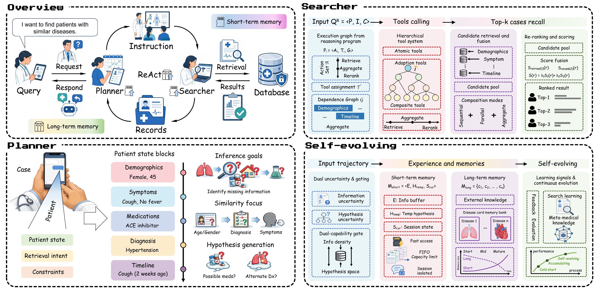

# PatientSearch-SE

## Abstract

Clinical case search aims to retrieve disease-consistent prior cases from electronic health record databases for a natural-language patient query under a retrieval objective. The task is challenging because patient queries contain heterogeneous evidence, including symptoms, diagnoses, laboratory results, treatments, and timelines. These fields are often only partially specified, requiring retrieval policies to dynamically adjust their behavior based on the available evidence and experience accumulated from prior search trajectories. Existing clinical retrieval methods typically flatten the query into a single representation or use static retrieval pipelines, while explicit mechanisms for cross-case adaptation remain an emerging research direction. **PatientSearch-SE** is a self-evolving framework for disease-centric clinical case search. It treats each query as a partially observed patient state, matching reliable evidence directly, completing consequential gaps with evidence-grounded hypotheses, and distilling successful search trajectories into reusable memory. This accumulated experience allows the framework to adapt its retrieval behavior to the information available in each case and guide subsequent searches without updating model parameters. The evaluation combines disease-centric retrieval outcomes with trajectory-level process probes for retrieval behavior analysis. Experiments on PMC-Patients and MIMIC-IV show higher disease-centric retrieval metrics for PatientSearch-SE than recent retrieval baselines across both datasets. Its ablation and memory-accumulation results provide evidence for the contribution of external memory to retrieval, and its retrieved cases provide additional evidence for diagnosis-masked downstream few-shot RAG prediction under this protocol.

**Code coming soon.**
